<div align="center">

# CardWise

**A personalized credit-card wallet planner. It finds the set of cards that pays you the most after fees, based on how you actually spend, travel and redeem.**

[](https://react.dev)
[](https://vitejs.dev)
[](#testing)
[](https://credit-card-optimizer-19762.web.app)
[](#simulations-and-validation)

**[Try it live](https://credit-card-optimizer-19762.web.app)**  |  [How it works](#how-recommendations-work)  |  [Validation](#simulations-and-validation)  |  [Methodology](docs/METHODOLOGY.md)

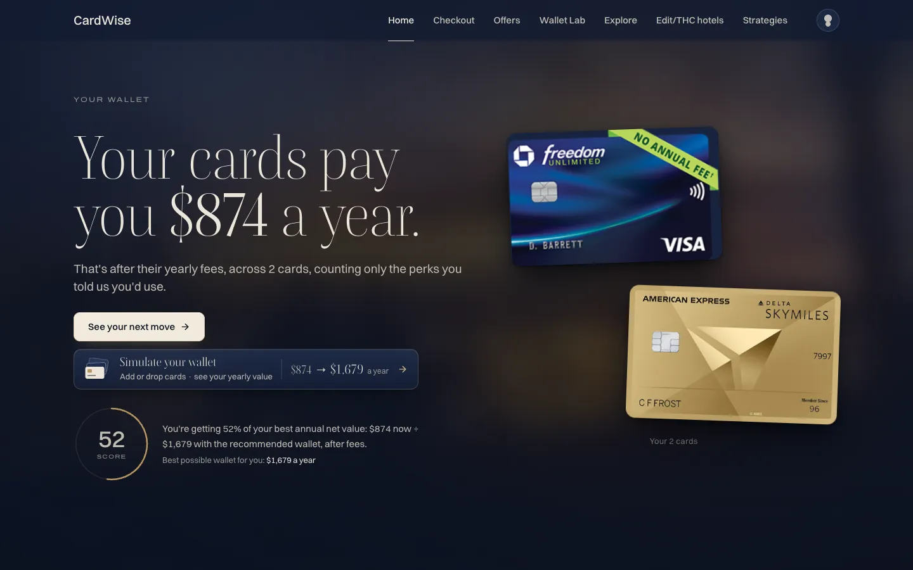

</div>

CardWise is not a "best cards" list. It asks how you spend, where you fly from, which hotels you use and which perks you would really use. Then it builds the set of cards that earns you the most, after annual fees.

- **Only real value counts.** A $300 credit for something you would never buy counts as $0. A perk you would only try if it were free also counts as $0.
- **Points are valued the way you would use them,** through the airline or hotel partner you would transfer to, not a generic average.
- **Hotel credits count only what they save you.** Each one is valued against what you would pay for a hotel anyway.
- **Every number shows its math,** from the earning on each category to each benefit and fee.
- **Runs in your browser.** There are no AI calls and the app needs no account.

## Table of contents

- [What it does](#what-it-does)
- [How recommendations work](#how-recommendations-work)
- [Hotel credits](#hotel-credits)
- [Simulations and validation](#simulations-and-validation)
- [Architecture](#architecture)
- [Data sources and attribution](#data-sources-and-attribution)
- [Privacy and security](#privacy-and-security)
- [Getting started](#getting-started)
- [Testing](#testing)
- [Project structure](#project-structure)
- [Roadmap and limitations](#roadmap-and-limitations)
- [Disclaimer](#disclaimer)

## What it does

The whole site opens on first visit with example strategies, so you can look around before answering anything. Take the survey (Quick, about 2 minutes, or Thorough, about 6) and every screen switches to your own numbers. The screenshots below use a synthetic example profile.

<table>
  <tr>
    <td width="50%">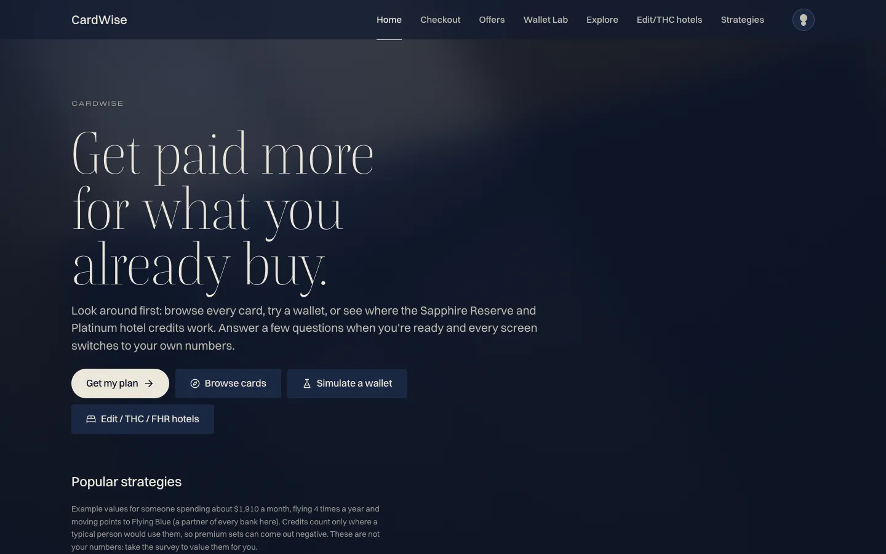<br /><b>Welcome.</b> Browse cards, simulate a wallet or see the hotel credits before answering any question.</td>
    <td width="50%"><br /><b>Home.</b> What your cards pay you a year, your score against the best possible wallet, and your next move.</td>
  </tr>
  <tr>
    <td>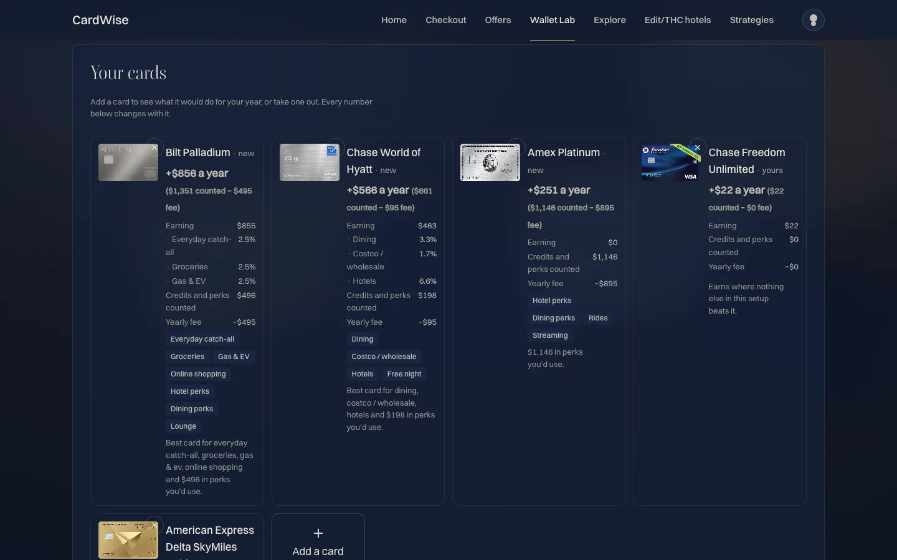<br /><b>Wallet Lab.</b> The best wallet for you, from your current cards or from scratch. Add or remove a card and every number changes. Shows which card to use where, and what to cancel or downgrade.</td>
    <td>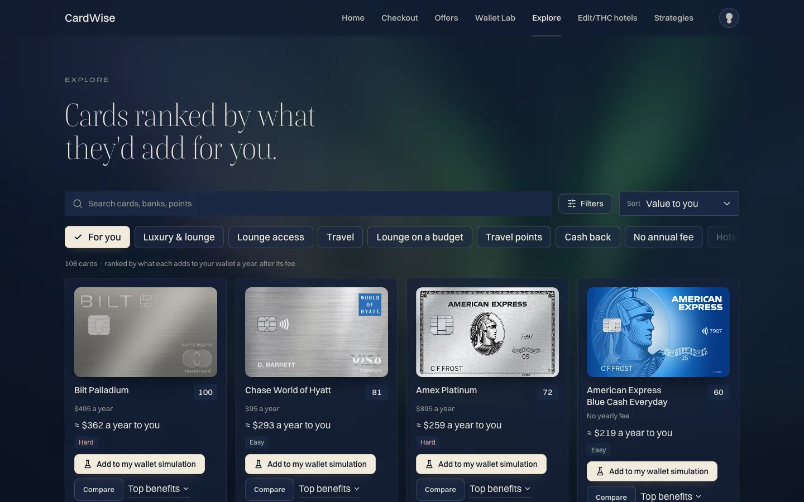<br /><b>Explore.</b> The card catalog, ranked by what each card would add to your wallet after its fee.</td>
  </tr>
  <tr>
    <td>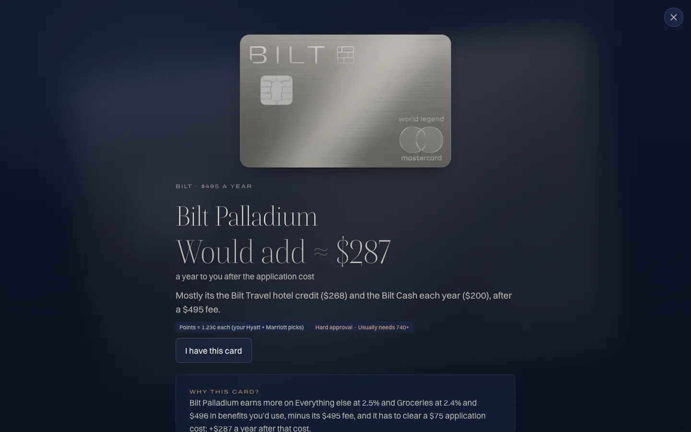<br /><b>Card detail.</b> "Why this card?", the benefits you would use, nice extras and the full math.</td>
    <td>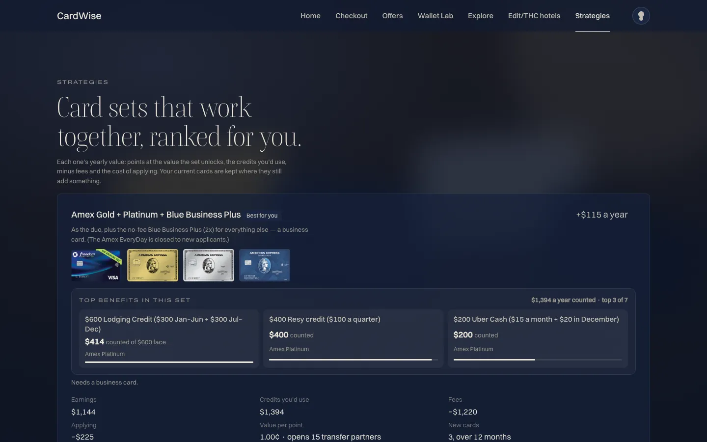<br /><b>Strategies.</b> Ready-made card sets (for example the Chase Trifecta or Amex Gold + Platinum), each valued for you. One tap sends a strategy to Wallet Lab or your plan.</td>
  </tr>
  <tr>
    <td>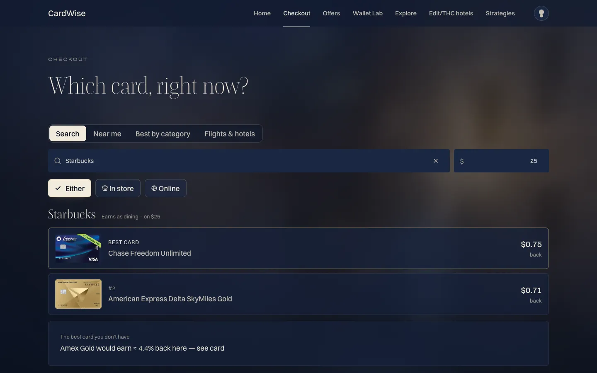<br /><b>Checkout.</b> Which card to use for a purchase right now, plus the best card you do not have.</td>
    <td>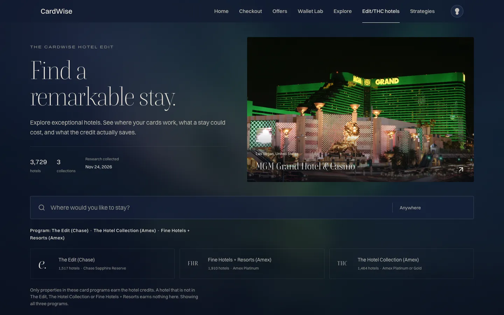<br /><b>Edit/THC hotels.</b> Where The Edit, Fine Hotels + Resorts and The Hotel Collection credits apply, with a map.</td>
  </tr>
</table>

Other screens: **Offers** (your bank card offers in one place, through the optional local connector and Chrome extension), **Your plan** (a card-by-card timeline for now and after your spending changes, following issuer rules such as Chase 5/24) and **Profile**.

<p align="center">
  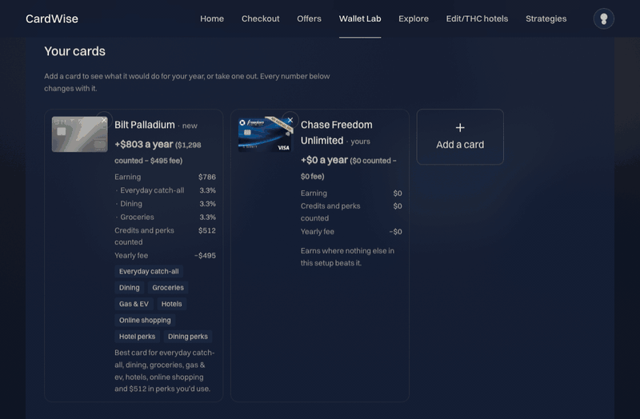<br />
  <sub>Wallet Lab: add a card and the whole wallet re-values. Here a Sapphire Preferred lets an existing Freedom Unlimited's points transfer, worth about $107 a year more for this example traveler, after the $95 fee.</sub>
</p>

<details>
<summary><b>Phone layout</b> (390 px wide)</summary>

<table>
  <tr>
    <td>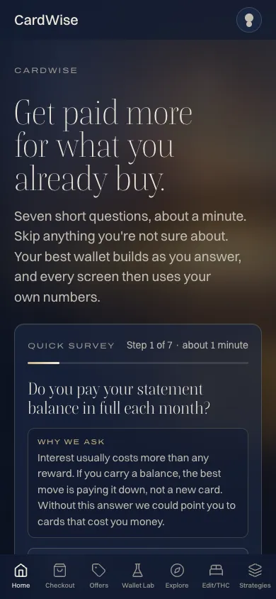</td>
    <td>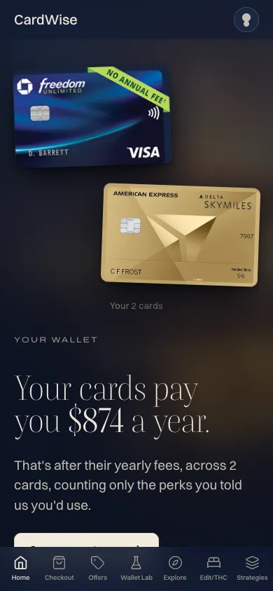</td>
    <td>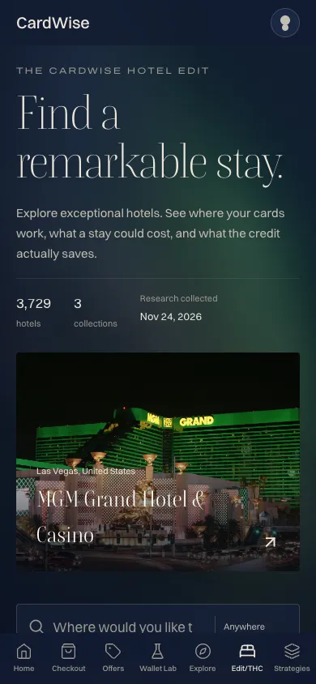</td>
  </tr>
</table>

</details>

## How recommendations work

For any set of cards, CardWise works out:

```
value = earning + benefits you would use - annual fees - what a basic 2% card would earn
```

An exact optimizer searches the catalog (130 cards from 18 issuers) for the wallet with the highest value, within your fee limit and card-count comfort. All screens read one shared plan (`src/engine/v5/plan.js`), so Home, Wallet Lab and the survey results never disagree. Skipped answers count cautiously and appear as editable "We assumed..." chips. A "Your plan depends on..." line names the unanswered question that would change the plan most.

### Decision flow

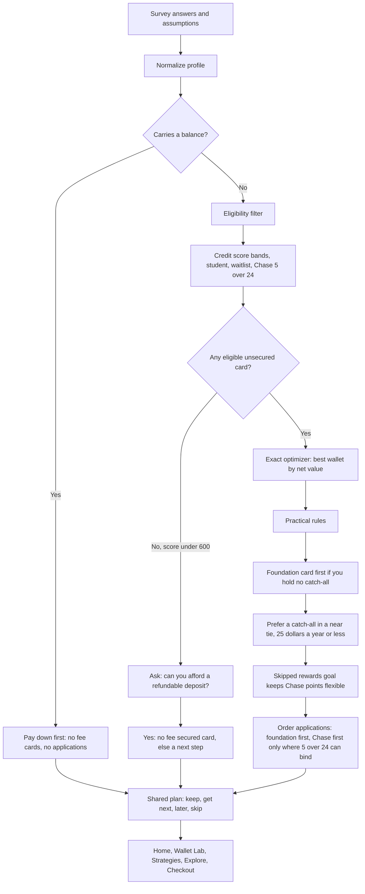

1. **Eligibility first.** A card you could not be approved for is never recommended. Student cards go only to students, waitlisted cards are never applications, and Chase cards are skipped at 5 or more new cards in 24 months.
2. **Balance-carrier guard.** If you carry a balance (45% in the Federal Reserve SHED survey), no annual-fee card is recommended, no new application is suggested, and the first step is paying down the balance.
3. **Deposit question.** Under a 600 score (or no history) with no eligible unsecured card, CardWise asks whether you can afford a refundable deposit before suggesting a secured card.
4. **Practical rules** (`src/engine/v5/practical.js`). The optimizer maximizes modeled net value, but a careful adviser would sometimes choose differently when the numbers are close. Three rules, all capped at a flat $25 a year of modeled value:
   - Start with a **foundation card**: a no-fee everyday card (at least 1.5% back on everything, or a better-valued no-fee card for you).
   - Order for **Chase 5/24 only when it can bind.**
   - Prefer a **catch-all** over a category card in a near-tie, since a category card depends on spending estimates and on remembering which card to use.

   A fourth rule keeps the Chase Ultimate Rewards ecosystem open when the rewards goal was skipped.
5. **Timeline.** Cards are ordered so the foundation card comes first and issuer limits are respected, with a "now" step and a "later" step after your spending changes.

<details>
<summary><b>Methodology deep dive: formulas and modeling choices</b></summary>

- **Earning.** Each spending category goes to the card with the highest net return (rate x value per point in this wallet), respecting caps. Overflow falls to the next best card.
- **Benefits.** Face value x how likely you are to use it, from your own habit answers. "Would start if free" counts $0. Lounges, Global Entry, CLEAR and protections are de-duplicated across a wallet.
- **Points.** Valued through the transfer partner you would use. For people who chose travel, fly 4 or more times a year and named no partner, points that can transfer are valued at a conservative 1.1 cents (Flying Blue, reachable from Chase, Amex, Citi, Capital One, Bilt and Wells Fargo). It shows in "We assumed..." and can be changed.
- **Hotel credits.** A credit C is valued as `clamp(C - nights x max(0, P - B), 0, C)`, where B is what you would pay a night anyway and P is the hotel's realistic price (your saved quote, a dated program price or a public-rate estimate). An estimate adds an 8% portal markup and 15% taxes and fees, both editable. Each credit's own rules apply: half-year periods, minimum nights (including dated changes) and separate stays. Credits across your cards share the hotel nights you actually have.
- **Fees.** Steady-state annual fee plus any required membership, plus an application cost for each new card.

The full method, every modeling default and each estimate it relies on: **[docs/METHODOLOGY.md](docs/METHODOLOGY.md)**. The practical rules and their before-and-after numbers: **[docs/PRACTICAL_RULES_REPORT.md](docs/PRACTICAL_RULES_REPORT.md)**.

</details>

## Hotel credits

Two premium cards include hotel credits that only work at specific programs. CardWise values them with one shared hotel-credit engine and the same rules the issuers state, with the issuer page and the date each was read recorded in the card data.

| Card | Credit | Where it applies | Rules modeled |
| --- | --- | --- | --- |
| Chase Sapphire Reserve | **$500** The Edit credit | The Edit (Chase) | $250 per prepaid stay of 2+ nights, two stays a year |
| Chase Sapphire Reserve | **$250** Select Hotels credit (2026 only) | Select Hotels | Prepaid, 2+ nights, ends 2026-12-31 |
| Amex Platinum | **$600** Lodging Credit | Fine Hotels + Resorts, The Hotel Collection, prepaid Airbnb Luxe via Amex Travel | $300 January-June and $300 July-December. The Hotel Collection and Airbnb Luxe need 2+ nights. Fine Hotels + Resorts needs 2+ nights from 2027-01-01. |

A credit is worth what it saves you, not its face value. A $300 credit at a $500-a-night hotel is not worth $300 to someone who usually pays $200 a night. The **Edit/THC hotels** tab lists the properties in each program (names, cities and map positions only), so you can see where a credit would apply. Mark a hotel "I'd stay here", "Too expensive" or "Not my style" and the credits re-value.

## Simulations and validation

CardWise is tested at three levels, and each result below is reproducible from the repo.

| Check | Population | Result |
| --- | --- | --- |
| Test suite | 131 files | **2,074 tests passing** |
| Math audit | 412 plans recomputed from their parts | **0 mismatches** across 2,857 earning rows and 780 strategy valuations |
| Training personas | 200 hand-written profiles, plus 200 known-answer replays and 12 balance carriers | Every changed plan documented |
| Held-out population | **5,000** synthetic people drawn from U.S. distributions | **0** violations on all 8 safety checks |

<details open>
<summary><b>Held-out population: 5,000 people the planner never saw during tuning</b></summary>

The practical rules and earlier fixes were tuned while looking at the 200 hand-written personas, so those 200 are a *training set*. To check the planner on people it had not been tuned on, `scripts/simulate-population.mjs` draws a synthetic population (seed 20261126). Credit bands come from Experian, the share carrying a balance (45%) from the Federal Reserve's SHED survey, and spending by income quintile from the BLS Consumer Expenditure Survey. Card share of each category, renting, travel frequency, subscriptions, cards held and skipped questions are labelled assumptions.

**Safety checks, all 5,000 people:** balance carriers given an annual-fee card 0, balance carriers told to apply 0, carriers whose first step is not paying down 0, ineligible new cards 0, student cards for non-students 0, waitlisted cards as applications 0, plans whose totals do not add up 0, first-card seekers left with no card and no next step 0.

**What people are told to apply for first:**

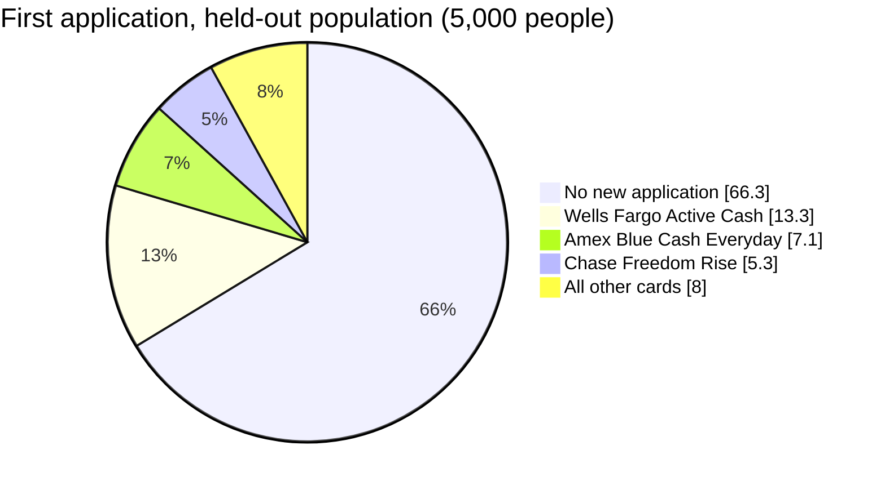

"No new application" covers balance carriers (45% of the population, told to pay down first), the deposit question, and people whose current cards already beat every addition after its application cost.

**Annual fees rise with income**, as they should: premium cards are recommended where spending and travel pay for them.

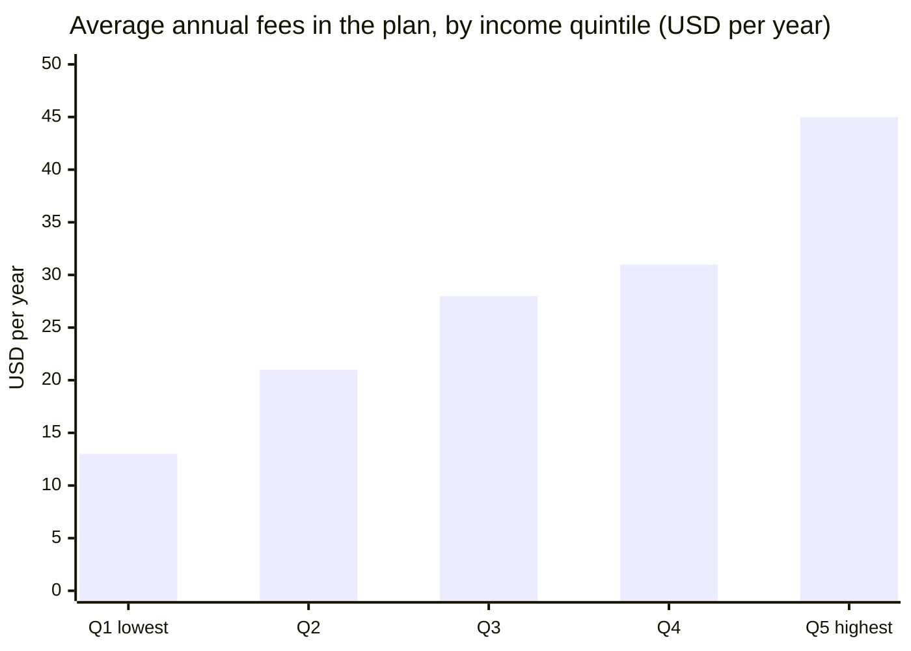

**Average net value by life-stage segment** (USD per year, after fees):

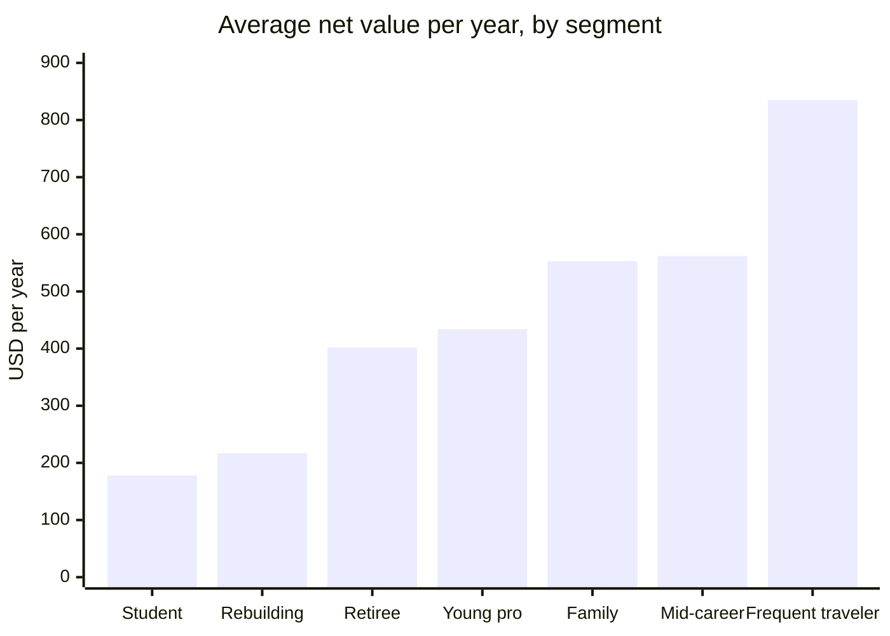

**Wallet size recommended** (number of people, of 5,000):

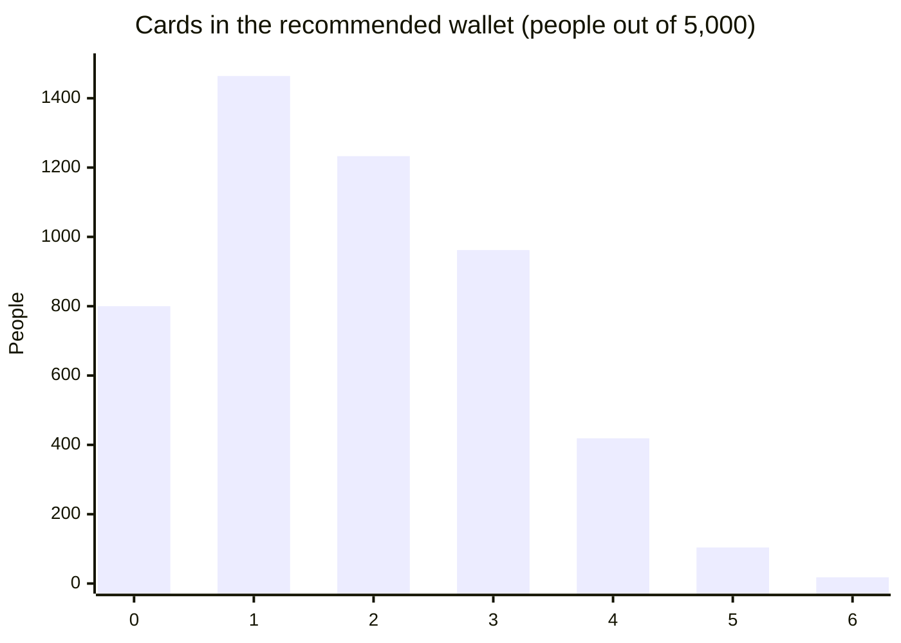

</details>

<details open>
<summary><b>Do the practical rules help? Training vs held-out, against an oracle</b></summary>

People misjudge their own spending, so each person is re-run 10 times with an independent lognormal error per category (sigma 0.35, about plus or minus 35%). The wallet recommended from the *stated* numbers is valued on the *true* numbers. An oracle that knows the true spending finds the best possible wallet, which gives the regret.

| Measure | Held-out (5,000) | Training (200) |
| --- | --- | --- |
| Plans the practical rules change | 46 (0.9%) | 9 (4.5%) |
| Realized net / year, rules on | $472 | $666 |
| Realized net / year, rules off (pure modeled optimum) | $472 | $667 |
| Rules on minus off, per person per year | -$0.12 | -$0.41 |
| Average regret vs oracle, rules on | $3.80 | $11.41 |
| Average regret vs oracle, rules off | $3.71 | $11.08 |
| Promised minus realized (optimizer's curse) | $2 | $3 |
| Plan changes after a 5% re-estimate of spending | 1.4% | 7.5% |

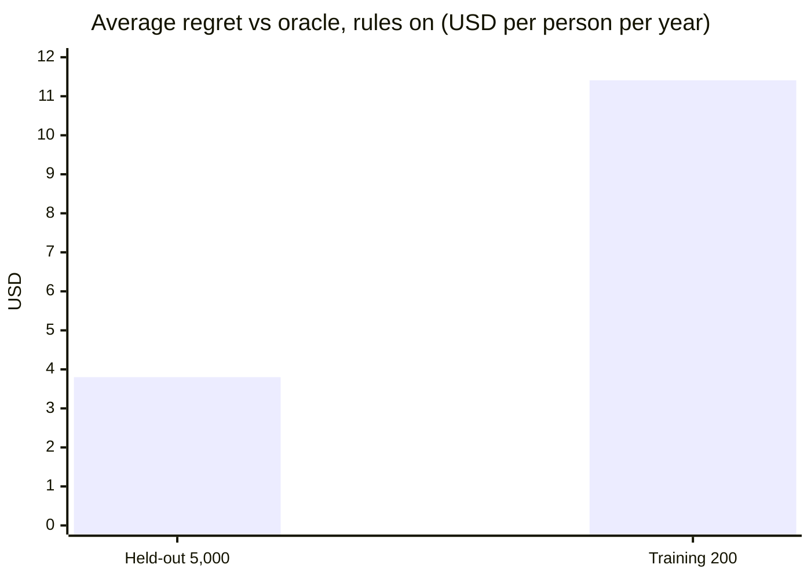

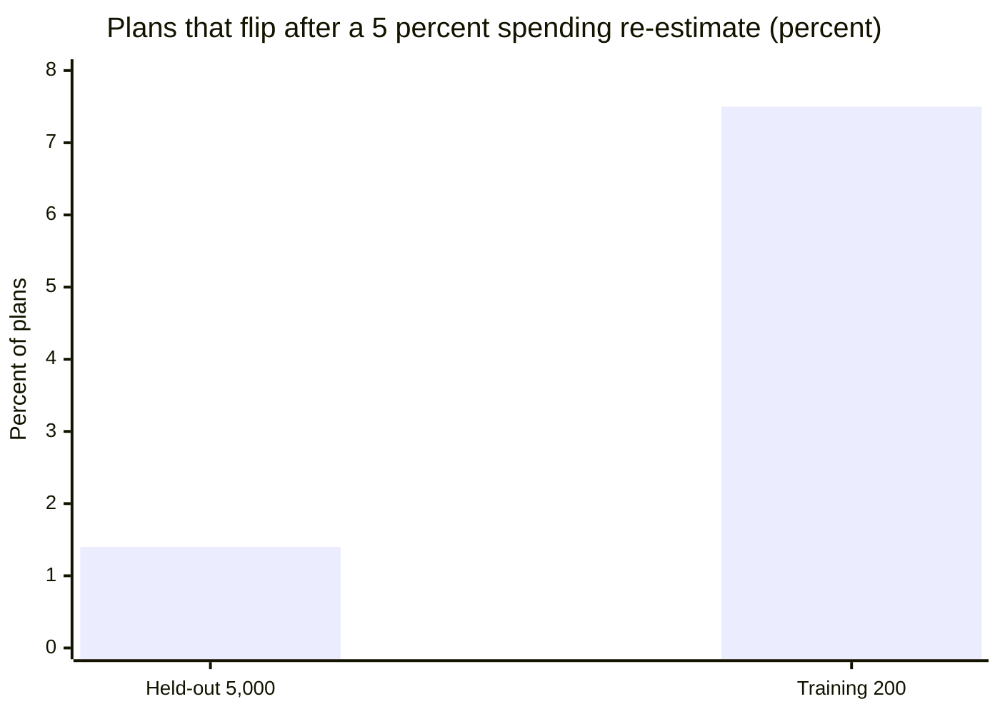

**Reading it honestly:**

- **The practical rules are value-neutral.** Under spending error they cost cents per person per year (-$0.12 held-out), and they change about 1 plan in 100. The simulation does not show a dollar gain from them. They stay for reasons it does not price: one simple card is easier to use correctly than several category cards, approval is easier, and Chase points keep the Sapphire upgrade path open.
- **The training personas over-represent edge cases.** The rules fire about 5x as often on the 200 hand-written personas as on the population, regret against the oracle is about 3x higher, and plans flip about 5x as often after a small re-estimate. They are good stress tests but not a representative sample. Population-level conclusions should come from the held-out run.
- **The optimizer's curse is small:** a few dollars a year, so recommended values are not materially inflated by picking the best of several noisy estimates.

**Limits of the simulation.** Spending error is modeled per category and independently, so correlated error (for example, everything overstated) and behaviour (using the wrong card at checkout) are not modeled. Approval is modeled by score bands and issuer rules, not by bank underwriting. The population's segment mix, subscriptions and held cards are assumptions; the credit, balance and spending distributions are sourced.

</details>

<details>
<summary><b>What the held-out run found and fixed</b></summary>

1. **A 580-599 credit gap.** Secured cards were offered only below 580, but the cheapest unsecured starter cards need 600, so people at 580-599 got no card and no next step. The secured cutoff now equals the starter threshold (600).
2. **Travel-goal points valued as cash.** Someone in Seattle or Atlanta who chose travel points saw every Chase or Capital One point as cash, because their inferred home airline was not a direct partner. Points that can transfer are now valued at a conservative 1.1 cents for people who chose travel.
3. **Existing Costco members penalised.** The extra margin for taking on a paid membership was also applied to people who already pay for Costco. It now applies only to new memberships.

Details: [docs/POPULATION_SIMULATION.md](docs/POPULATION_SIMULATION.md). Raw numbers: [docs/population-simulation-results.json](docs/population-simulation-results.json) and [docs/simulation-results.json](docs/simulation-results.json) (the 200 personas).

**Dataset for your own analysis:** [docs/data/ml/](docs/data/ml/README.md) has one CSV row per synthetic person (5,000 × 57 columns: features, recommendation, Monte Carlo outcomes), 50,000 per-draw rows, and the 200 training personas in the same format. Regenerate with `node scripts/population/export.mjs`.

</details>

<details>
<summary><b>Math audit and reproduction commands</b></summary>

`npm run audit:math` recomputes 412 plans from their parts (the 200 original profiles, 200 known-answer replays and 12 balance carriers). It checks that earning = the sum of its rows, benefits = the sum of counted benefits, fees = the sum of fees and net = earning + benefits - fees; that the plan net equals the shared wallet valuation; that no credit is counted above face value; that no spending category is routed twice; and that strategy figures match the wallet valuation. Result: 0 mismatches.

```bash
node scripts/simulate.mjs              # the 200 training personas, their replays and 12 balance carriers
node scripts/simulate-population.mjs   # the 5,000-person held-out population
node scripts/population/report.mjs     # the report tables
npm run audit:math                     # recompute 412 plans from their parts
```

More: [docs/AUDIT_FIX_REPORT.md](docs/AUDIT_FIX_REPORT.md), [docs/simulations.md](docs/simulations.md).

</details>

## Architecture

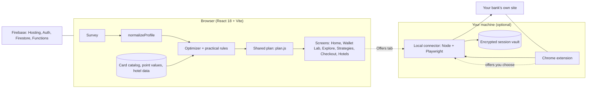

- **Engine** (`src/engine/v5/`) is framework-free and pure: valuation, optimizer, plan and explanation logic. React screens only render what the shared plan decides.
- **Data** (`src/data/`) holds the card catalog, point values, transfer partners, airports, perk habits and hotels.
- **Connector and extension** are optional. They bring your bank's card-linked offers into the Offers tab.
- **Firebase** serves the static build from Hosting and handles sign-in and saved profiles.

## Data sources and attribution

Card terms come from each issuer's own pages; every credit records the page it was read from and the date. Full text and licences are in **[docs/THIRD_PARTY.md](docs/THIRD_PARTY.md)**.

| Data | Source | Use |
| --- | --- | --- |
| Card terms and credits | Issuer pages (read and dated in the card data) | Catalog and valuation |
| Credit score bands | Experian, 2025 FICO score distribution | Held-out simulation |
| Share carrying a balance | Federal Reserve, Economic Well-Being of U.S. Households (SHED) | Simulation and balance-carrier guard |
| Spending by income quintile | BLS Consumer Expenditure Survey 2024 | Simulation |
| Airline routes | US DOT BTS T-100 Segment (All Carriers), 2025-09 to 2026-08, public domain | Airline inference from your airport |
| Store brands | [name-suggestion-index](https://github.com/osmlab/name-suggestion-index), BSD-3-Clause | Checkout search |
| Nearby stores, geocoding | OpenStreetMap contributors (Overpass and Nominatim), ODbL | Checkout "Near me", hotel map positions |
| Hotel program lists | AwardHelper (awardhelper.com) and edithotelsearch.com, **facts only** | Edit/THC hotels tab |
| Premium hotel nightly rates | nextcard city guides (dated snapshots, 10 cities) | Valuing hotel credits |
| Hotel photographs | Wikimedia Commons, with author and licence credit shown in the app | Five property photos |
| Fonts | Fontshare (Boska, Switzer), Google Fonts (Archivo, SIL OFL 1.1) | Self-hosted |
| Card images | Issuers' artwork, to identify each card in this non-commercial project | Profile can switch to CardWise's own designed faces |

<details>
<summary><b>Hotel directory: what is and is not published</b></summary>

The Hotels tab lists every hotel in The Edit (Chase Sapphire Reserve), Fine Hotels + Resorts and The Hotel Collection (Amex), so cardholders can see where those credits apply. The public build holds **facts only**: each property's name, city, country, region, program memberships and coordinates. It does not include prices, perk text, issuer property URLs or any workbook. A test (`src/__tests__/hotelPublicBoundary.test.js`) fails if the public file gains any other field.

Attribution shown in the tab footer: "List via AwardHelper (awardhelper.com)", "Edit list via edithotelsearch.com" and "Geocoding (c) OpenStreetMap contributors (Nominatim, ODbL)". Written permission from AwardHelper and edithotelsearch is still outstanding; on a takedown request, the affected entries are removed and the build is regenerated. Hotel prices are dated planning observations, not issuer portal quotes. Amex Travel and Chase are not scraped, because their terms prohibit automated access.

</details>

## Privacy and security

- **Your answers stay in your browser** unless you sign in, in which case your profile is saved to your own Firebase account.
- **Your bank login happens on your bank's own page.** The connector never sees or stores a password, only an encrypted session (AES-256-GCM, per user and per bank). The Chrome extension never runs on a sign-in page, has no cookie access, keeps only the last 4 digits a page shows, and its permission is `storage` only.
- **The connector token never ships in the web bundle.** `npm run build` runs `scripts/check-dist-secrets.mjs` after the build and fails if `dist/` contains the connector token name or any nonempty `.env.local` value.
- **Local files stay local.** `.env` files and the large personal hotel lists are git-ignored and never part of the public build.
- Rotate the connector token and vault key with `npm run keys`. More in [connector/README.md](connector/README.md) and [extension/README.md](extension/README.md).

## Getting started

```bash
git clone https://github.com/SHLEW06/CardWise.git
cd CardWise
npm install
npm run dev            # http://localhost:5173
```

The public build uses a research-based hotel database plus the facts-only program directory. Larger personal hotel lists load on `npm run dev` only if you have generated them locally (`npm run hotel-db`); they are git-ignored.

Optional bank-offer sync: `npm run dev:all` starts the app and the local connector (see [connector/README.md](connector/README.md)), then load [extension/](extension/README.md) unpacked in Chrome.

Deploy: `npm run build && firebase deploy --only hosting`.

<details>
<summary><b>All npm scripts</b></summary>

| Script | What it does |
| --- | --- |
| `npm run dev` | Vite dev server (builds the card-art manifest first) |
| `npm run dev:all` | App plus local connector together |
| `npm run build` | Production build, then the dist secret scan |
| `npm run preview` | Serve the production build locally |
| `npm run deploy` | Build, then `firebase deploy` |
| `npm test` | Vitest, run once |
| `npm run test:watch` | Vitest in watch mode |
| `npm run test:extension` | Chrome extension tests (Node test runner) |
| `npm run test:connector` | Connector tests, including a mock-bank login, sync and add flow |
| `npm run test:all` | All three suites |
| `npm run audit:math` | Recompute 412 plans from their parts |
| `npm run audit:cards` | Card data audit |
| `npm run audit:v7c` | Card audit, v7c checks |
| `npm run golden` | Golden-profile report |
| `npm run connector` | Start the connector alone |
| `npm run keys` | Rotate the connector token, keeping its vault key |
| `npm run calibrate` | Connector bank-page calibration |
| `npm run extension:calibrations` | Sync calibrations into the extension |
| `npm run art`, `art:missing`, `art:fetch`, `art:sources` | Card-art manifest and sources |
| `npm run fonts` | Download the self-hosted fonts |
| `npm run brands` | Rebuild store brands from name-suggestion-index |
| `npm run routes` | Rebuild airline routes from BTS T-100 |
| `npm run hotels` | Rebuild premium hotel prices |
| `npm run hotel-db` | Build the local personal hotel database |
| `npm run hotels:public` | Rebuild the facts-only program hotel list |
| `node scripts/simulate.mjs` | Run the 200 training personas |
| `node scripts/simulate-population.mjs` | Run the 5,000-person held-out population |
| `node scripts/readme/shoot.mjs` | Re-take the README screenshots (needs the dev server and Chrome) |
| `node scripts/readme/gif.mjs` | Re-record the Wallet Lab clip (needs ffmpeg) |

</details>

## Testing

```bash
npm test                  # 131 files, 2,074 tests: engine, UI and the 200-persona regressions
npm run test:extension    # Chrome extension
npm run test:connector    # connector, incl. a full login, sync and add flow against a mock bank
npm run test:all          # everything above
npm run audit:math        # 412 plans recomputed from their parts, 0 mismatches
node scripts/simulate.mjs             # 200 training personas
node scripts/simulate-population.mjs  # 5,000-person held-out population
```

The connector tests use Chrome (`CHROME_CHANNEL=chrome` by default). Some hotel-workbook tests skip themselves on a fresh clone because the local-only workbook is not in the repository.

## Project structure

```
src/
  engine/v5/     valuation, optimizer, practical rules, plan, hotel credits (framework-free)
  engine/        shared profile defaults, scoring and legacy helpers
  data/          card catalog (cards/), point values, transfer partners, airports, perk habits, hotels
  components/    React UI (v5 shell and survey, v7 screens: Welcome, Strategies, Hotels, ...)
  state/         profile persistence (local first, Firestore when signed in)
  firebase/      auth and Firestore wiring
  styles/        CSS
  __tests__/     Vitest suites
connector/       local bank-offer connector (Node, Playwright, encrypted vault, mock bank)
extension/       Chrome extension for Amex and Chase offers
functions/       Firebase Functions
scripts/         builders, audits, simulations, screenshot tools
  population/    held-out population generator and report
  readme/        README screenshot and clip scripts
docs/            methodology, simulation reports, audit reports, third-party data notes
  assets/readme/ README images
firebase.json    Hosting config (serves dist/, SPA rewrite, immutable cache for js and css)
```

## Roadmap and limitations

- **Modeled, not guaranteed.** Values depend on the spending and habits you enter and on dated point values and credit terms. Skipped answers are assumed conservatively and listed.
- **Approval is a model.** It uses score bands and issuer rules such as Chase 5/24, not bank underwriting.
- **Hotel prices are snapshots.** They are dated planning observations, not live quotes. A live price source with authorized access is not wired in.
- **Hotel list permissions.** Written permission from the two list sites is still outstanding (see the hotel directory note above).
- **Simulation scope.** Correlated spending error and checkout behaviour are not modeled, and the population's segment mix is an assumption.
- **U.S. cards only,** and the catalog is a snapshot (130 cards, 18 issuers).
- **Bank offers** need the local connector or the Chrome extension, which are optional and run on your machine.

## Disclaimer

CardWise is a personal project, not financial advice. Card terms, credits and point values change often, so always check the issuer's current terms before applying. Card images are the issuers' artwork, used only to identify each card in this non-commercial project.

*Personal project, 2026.*
