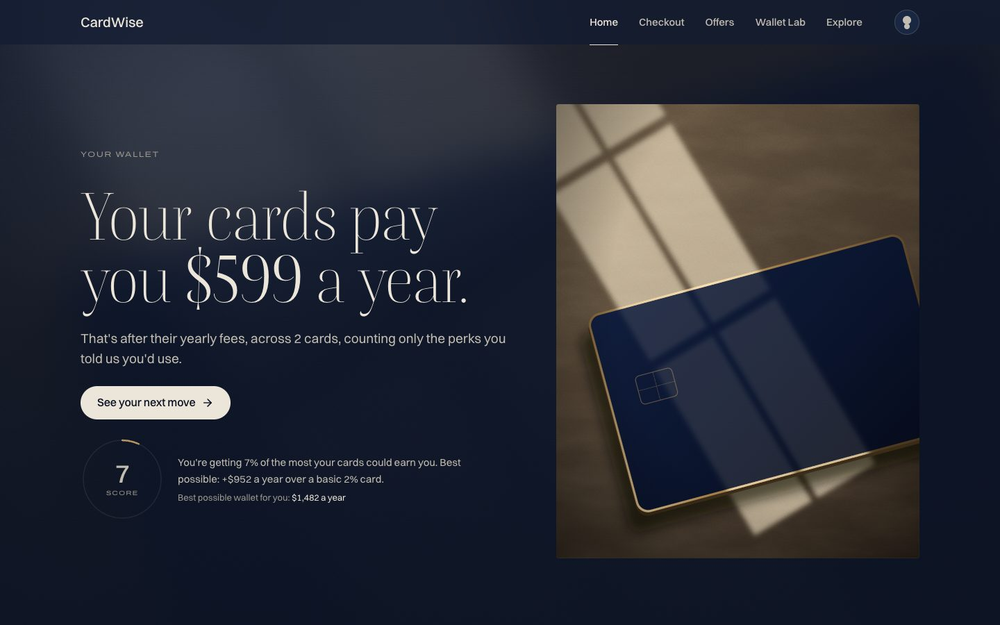
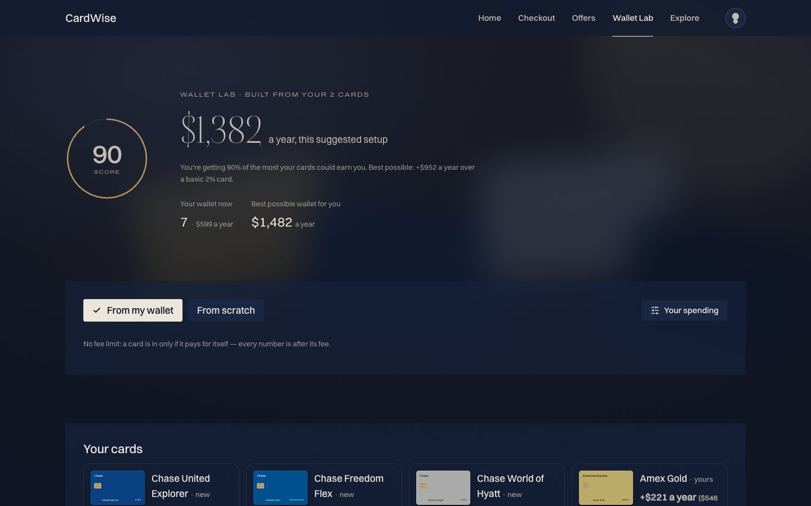

# CardWise

**Find the credit cards that actually pay you, based on how you spend and travel.**

**[Try it live →](https://credit-card-optimizer-19762.web.app)**



CardWise isn't a "best cards" list. It asks how you spend, where you fly from, which hotels you use and which perks you'd really use. Then it builds the set of cards that earns you the most, after annual fees.

- **Only real value counts.** A $300 credit for something you'd never buy counts as $0. A perk you'd only try if it were free also counts as $0.
- **Points are valued the way you'd use them,** through the airline or hotel partner you'd transfer to, not a generic average.
- **Hotel credits count only what they save you.** Each one is valued against what you'd pay for a hotel anyway. A $300 credit at a $500-a-night hotel isn't worth $300 to someone who usually pays $200.
- **Every number shows its math,** from the earning on each category to each benefit and fee.

## Features

| | |
|---|---|
| **Setup survey** | Quick (2 min) or Thorough (6 min). Covers your cards, spending, travel, perk habits and credit. |
| **Home** | What your cards pay you a year, your score, and your next move. |
| **Wallet Lab** | The best wallet for you, from your current cards or from scratch. Shows which card to use where, and what to cancel or downgrade. |
| **Your plan** | A card-by-card timeline for now and after your spending changes (e.g. after graduating). Follows issuer rules like Chase 5/24. |
| **Strategies** | 14 ready-made card sets (for example, the Chase Trifecta, Amex Gold + Platinum, or Hyatt via Chase), each valued for you. Shows what you'd keep, add or downgrade and which card to use for what. One tap sends a strategy to Wallet Lab or your plan. |
| **Hotels** | Hotels where The Edit, Fine Hotels + Resorts, The Hotel Collection and similar programs apply, with a map. Each shows a dated price and its value to you. Mark a hotel "I'd stay here", "Too expensive" or "Not my style", and the credits re-value. |
| **Explore** | 106 open cards, ranked by what each would add to *your* wallet. |
| **Card detail** | "Why this card?", the benefits you'd use, nice extras, and the full math. |
| **Checkout** | Which card to use for a purchase right now. |
| **Offers** | Your bank card offers in one place (local connector and Chrome extension). |

<table>
  <tr>
    <td></td>
    <td></td>
  </tr>
</table>

## How it works

For any set of cards, CardWise works out:

```
value = earning + benefits you'd use − annual fees − what a basic 2% card would earn
```

A hotel credit C is valued as

```
value = clamp(C − nights × max(0, P − B), 0, C)
```

where B is what you'd pay a night anyway and P is the hotel's realistic price. P is your saved quote, a dated program price, or a public-rate estimate. An estimate gets a portal markup (8%) and taxes and fees (15%) added, both editable. Each credit's own rules apply: half-year periods, minimum nights (including dated changes, such as Fine Hotels + Resorts moving to two nights in 2027) and separate stays. Hotel credits across your cards share the hotel nights you actually have.

An exact optimizer searches the catalog for the wallet with the highest value. The catalog has 130 cards from 18 issuers. The full method, every modeling default, and each estimate it relies on are in **[docs/METHODOLOGY.md](docs/METHODOLOGY.md)**.

All calculations run in your browser. There are no AI calls, and the app needs no account.

## Run it locally

```bash
npm install
npm run dev        # http://localhost:5173
npm test           # Vitest engine, UI and 200-persona regressions
npm run build      # production build → dist/
npm run keys       # rotate the connector token locally; preserves its vault key
```

**Deploy:** `npm run build && firebase deploy --only hosting`

The public build uses a 37-hotel research database. On `npm run dev`, the app also loads larger personal hotel lists if you've generated them locally (`npm run hotel-db`). Those are gitignored and never included in the public build.

Survey results, Home and Wallet Lab share `src/engine/v5/plan.js`. Skipped spending/travel answers count cautiously and appear as editable assumptions. Reproduce the audit with `node scripts/simulate.mjs`; see [the fix report](docs/AUDIT_FIX_REPORT.md). The build fails if `dist/` contains the connector token name or any nonempty `.env.local` value. Production bank sync expects a connector reverse proxy at `/connector`; development uses the local connector URL and dev-only token.

**Built with:** React 18, Vite 5, Vitest, Firebase Hosting.

## Project layout

```
src/
  engine/v5/     valuation, optimizer, plan and explanation logic (framework-free)
  data/          card catalog, point values, transfer partners, airports, perk habits, hotels
  components/    React UI
  __tests__/     Vitest suites
connector/       local bank-offer connector (optional)
extension/       Chrome extension for Amex / Chase offers (optional)
docs/            methodology, progress log, acceptance report
```

## Notes

- **Not financial advice.** Card terms change often, so always check the issuer's current terms before applying. Each credit records the issuer page it was read from and the date.
- **Card images.** The card photos are the issuers' artwork, used to identify each card in this non-commercial project. Profile has a switch to CardWise's own designed faces instead.

*Personal project, 2026.*
