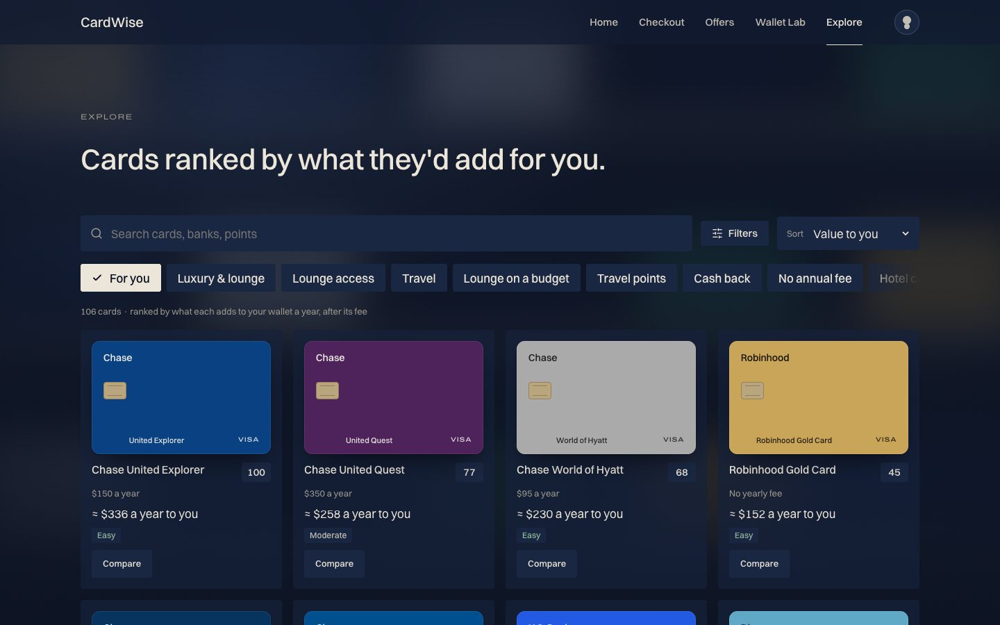

# CardWise

**Find the credit cards that actually pay you, based on how you spend and travel.**

**[Try it live →](https://credit-card-optimizer-19762.web.app)**


CardWise isn't a "best cards" list. It asks how you spend, where you fly from, which hotels you use and which perks you'd really use. Then it builds the set of cards that earns you the most, after annual fees.

- **Only real value counts.** A $300 credit for something you'd never buy counts as $0. A perk you'd only try if it were free also counts as $0.
- **Points are valued the way you'd use them,** through the airline or hotel partner you'd transfer to, not a generic average.
- **Every number shows its math,** from the earning on each category to each benefit and fee.

## Features

| | |
|---|---|
| **Setup survey** | Quick (2 min) or Thorough (6 min). Covers your cards, spending, travel, perk habits and credit. |
| **Home** | What your cards pay you a year, your score, and your next move. |
| **Wallet Lab** | The best wallet for you, from your current cards or from scratch. Shows which card to use where, and what to cancel or downgrade. |
| **Your plan** | A card-by-card timeline for now and after your spending changes (e.g. after graduating). Follows issuer rules like Chase 5/24. |
| **Explore** | 106 open cards, ranked by what each would add to *your* wallet. |
| **Card detail** | "Why this card?", the benefits you'd use, nice extras, and the full math. |
| **Checkout** | Which card to use for a purchase right now. |
| **Offers** | Your bank card offers in one place (local connector and Chrome extension). |

<table>
  <tr>
    <td></td>
    <td></td>
  </tr>
</table>

## How it works

For any set of cards, CardWise works out:

```
value = earning + benefits you'd use − annual fees − what a basic 2% card would earn
```

An exact optimizer searches the catalog for the wallet with the highest value. The catalog has 130 cards from 18 issuers. The full method, every modeling default, and each estimate it relies on are in **[docs/METHODOLOGY.md](docs/METHODOLOGY.md)**.

All calculations run in your browser. There are no AI calls, and the app needs no account.

## Run it locally

```bash
npm install
npm run dev        # http://localhost:5173
npm test           # 1,624 tests (Vitest)
npm run build      # production build → dist/
```

**Deploy:** `npm run build && firebase deploy --only hosting`

**Built with:** React 18, Vite 5, Vitest, Firebase Hosting.

## Project layout

```
src/
  engine/v5/     valuation, optimizer, plan and explanation logic (framework-free)
  data/          card catalog, point values, transfer partners, airports, perk habits
  components/    React UI
  __tests__/     Vitest suites
connector/       local bank-offer connector (optional)
extension/       Chrome extension for Amex / Chase offers (optional)
docs/            methodology, progress log, acceptance report
```

## Notes

- **Not financial advice.** Card terms change often, so always check the issuer's current terms before applying.
- **No real card images in the repo.** Issuer card photos are personal-use only and stay on the owner's machine. The public app shows designed card faces instead.

*Personal project, 2026.*
