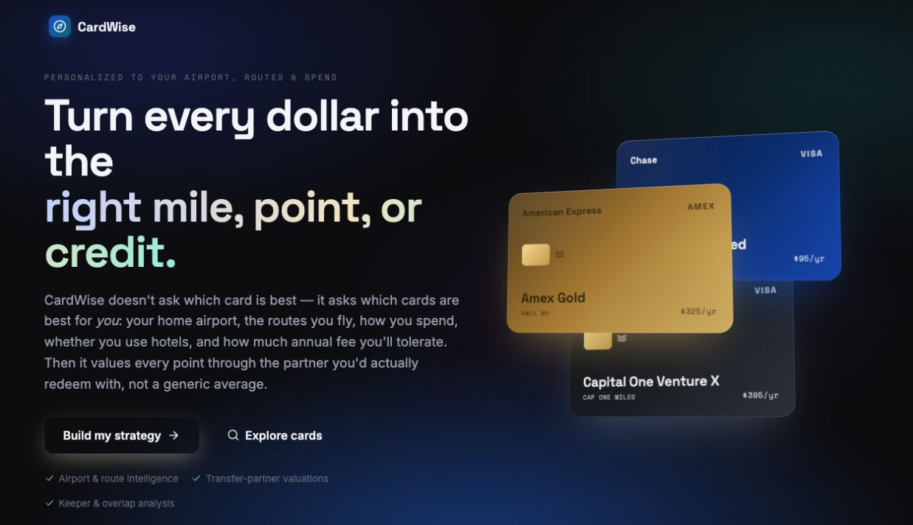

# CardWise

**Turn every dollar into the right mile, point, or credit.**

CardWise is a personalized credit-card **strategy engine** — not a "best cards"
list. It asks where you fly from, the routes you take, how you spend, whether
you actually use hotels, and how much annual fee you'll tolerate, then builds
a wallet around **you**.

Crucially, it values transferable points *through the specific partner you'd
redeem with* (Amex MR → ANA, Chase UR → Hyatt, Cap One → Aeroplan …) rather
than a blanket cents-per-point average. It focuses on **ongoing value** —
category multipliers, per-user CPP, credits you'd actually use, checked bags,
companion + free-night certificates, lounge access, status, transfer sweet
spots, annual-fee break-even, and benefit overlap — **not** signup bonuses.



## At a glance

| Card catalog | Strategy engine | Automated tests | Runtime |
|---:|---:|---:|---|
| 83 cards | 26 pure-logic modules | 900 tests across 47 files | Local-first React app |

The engine can recommend a best next card, identify cards to keep or
downgrade, route a purchase across the current wallet, and explain how airport,
route, fee, and redemption preferences changed the result.

---

## Quick start

```bash
npm install
npm run dev          # http://localhost:5173
```

Build for production:

```bash
npm run build        # outputs to dist/
npm run preview      # preview the production build locally
npm run test         # run vitest
```

The app runs **fully without any backend** — auth and persistence fall back to
local browser storage until you wire up Firebase.

### Bank connections (Offers tab)

The connector in `connector/` signs into banks through a streamed browser
(you type your own credentials into your bank's page; it keeps only an
encrypted session). To run it next to Vite:

```bash
npm --prefix connector install
npm --prefix connector run keys     # once: writes connector/.env (API token + vault key, CHROME_CHANNEL=chrome)
```

Then create `.env.local` in the app folder:

```
VITE_CONNECTOR_URL=http://127.0.0.1:8787
VITE_CONNECTOR_TOKEN=<CONNECTOR_TOKEN from connector/.env>
```

and start both:

```bash
npm run dev:all      # Vite on :5173 + the connector on :8787
```

**Amex and Chase sync through the CardWise Chrome extension** (they block
automated sign-ins): load `extension/` unpacked in Chrome (steps in
`extension/README.md`), open the app so it links itself, then open your
bank's offers page. Connected banks (Offers tab, Profile) shows which mode
each bank uses.

Teach it a bank once with your own account, from a HAR you export in your
own Chrome: `npm run calibrate -- amex --har connector/data/amex.har` (and
`chase`) — see `connector/README.md`.

Tests: `npm test` (app), `npm run test:extension`, `npm run test:connector`
(needs Chrome; the extension e2e uses Playwright's cached Chrome for Testing),
or `npm run test:all`.

Other scripts: `npm run brands -- <nsi.min.json>` rebuilds the Checkout store
list (see `docs/THIRD_PARTY.md`); `npm run art` rebuilds the card-photo
manifest (Vite also does this live).

---

## Deploy to Firebase Hosting

```bash
npm install -g firebase-tools
firebase login
# set your project id in .firebaserc (replace "your-cardwise-project-id")
npm run deploy       # = vite build && firebase deploy
```

`firebase.json` serves the Vite `dist/` folder and rewrites all routes to
`index.html` for the single-page app. Immutable cache headers are set on
JS/CSS assets.

### Wiring real Firebase (optional)

1. Create a Firebase project; enable **Authentication** and **Cloud Firestore**.
2. Copy `.env.example` → `.env` and paste your web config values.
3. `npm i firebase` (already a dependency).
4. `src/firebase/config.js` reads `VITE_FB_*` env vars at build time. Anywhere
   `getFirebase()` returns `null`, the client silently falls back to the same
   local-storage shape.

Firestore paths, mirrored 1-for-1 by the local fallback so the swap is
mechanical:

```
users/{uid}
users/{uid}/wallet/{cardId}
users/{uid}/spendProfiles/{id}
users/{uid}/strategies/{id}
users/{uid}/redemptionSearches/{id}
cardDataSnapshots/{snapshotId}
```

---

## How it's organized

```
src/
  data/         seed data — 83 cards (78 consumer + 5 business), enriched
                on load; programs, transfer partners, valuations, airports,
                route profiles, archetypes, issuer rules, sample profiles
  engine/       pure logic (26 modules) — scoring, marginal-value, keeper
                analyzer, wallet optimizer, spend router, transfer valuation,
                airport + route fit, fit adjustments, overlap detection,
                approval realism, value breakdown, redemption math, role
                recommendations, decision rules, timeline builder
  components/   React UI (25 files) — Hero, Onboarding, StrategyDashboard,
                TimelineView, SpendRouter, CardExplorer, CardComparison,
                CardTile, KeeperAnalyzer, AirportFit, RedemptionExplorer,
                WalletBuilder, WarningsPanel, CardArt, CardModal,
                dashboard/{ValueBreakdown, RoleAlternativesPanel, …}
  firebase/     config + auth + firestore (all with local fallback), plus
                the local deterministic narrator
  styles/       animations.css (shared keyframes) + globals.css (tokens,
                shell, card art, aurora, glass panels, mobile responsive)
                + cardwise.css (screen-specific)
  __tests__/    900 vitest tests across 47 files
```

The **engine is deliberately framework-free** — every function takes a
profile + data and returns a plain-JS result, so it's easy to test, reuse on
a server, or feed to a future strategist later.

---

## Deterministic strategy engine

CardWise makes decisions from a chain of pure functions. **No LLM decides
anything** — the engine is authoritative, deterministic, and reproducible.

### The chain

1. **`surveyScoring.normalizeUserProfile(raw)`** — takes the raw onboarding
   answers (or a sample profile) and produces a canonical profile with
   nested (`profile.basics.*`, `profile.travel.*`, …) and legacy-flat
   (`homeAirport`, `feeBudget`, …) fields, plus a `derived` block
   (travelIntensity, hotelIntensity, likely archetypes).
2. **`scoring.buildSpend(profile)`** — turns spend chips / dollar amounts
   into a canonical monthly-dollar map by engine category.
3. **`transferValue.effCpp(program, profile, held)`** — for every currency,
   picks a partner anchor and computes cents-per-point *through that
   partner*. Reads `data/valuations.js` (which now carries conservative /
   expected / aspirational tiers per currency + skill blend).
4. **`marginalValue.calculateMarginalCardValue(card, profile, wallet)`** —
   the core "how much does THIS card add to THIS wallet?" number. See
   [Marginal-value methodology](#marginal-value-methodology).
5. **`decisionRules.classifyRecommendation(mv, {card, profile})`** — turns
   the marginal number + card availability + approval into one of 12
   decision labels (Best Next, Wait Until Approval, Product Change Target,
   Downgrade Path Only, Not Worth Fee, etc.).
6. **`walletOptimizer.optimizeWallet(profile, currentWallet)`** — the
   dashboard's one-shot call: returns `bestNext`, `laterCards`, `avoid`,
   `walletMoves`, `idealWallet`, and `byRole` recommendations.
7. **`fitAdjustments.computeFitAdjustment(card, profile)`** — bounded ±$/yr
   adjustment for airport + route + travel-behavior fit (see [Airport /
   route fit is advisory](#airport--route-fit-is-advisory)).

Companion modules attach to the same profile:

- `keeperAnalyzer` — Strong Keep / Keep For Specific Use / Keep But Stop
  Spending / Downgrade At Renewal / Product Change Candidate / Cancel At
  Renewal / Reconsider Later, with an explicit preservation rule for $0
  no-fee cards (they anchor credit-history utilization).
- `overlapDetector` — flags overlap between held cards (Sapphire pair,
  Marriott cert stack, hotel-cert conflict, etc.).
- `valueBreakdown` — realistic net value + possibleMax + per-benefit split
  + confidence + explanations for weak signals.
- `redemptionMath.evaluateRedemption(...)` — for a specific award,
  true CPP + difficulty + availability risk + warnings.
- `cardRouter` — spend router: for a purchase, ranks wallet cards and
  compares against the flat-2% baseline; applies FX + processing-fee
  haircuts for rent / tuition.

---

## Marginal-value methodology

The single most important idea in CardWise: **a candidate card is only as
valuable as the delta between the wallet's value WITH it and WITHOUT it**.

For each card, the engine computes:

```
walletValue(cards)  =  categoryRewards       // spend routed to best-earning card, valued
                        + benefitValue        //   through the chosen transfer anchor
                        − feeValue            // annual fee + any required membership

marginalValue(card, profile, wallet) =
     walletValue(wallet + card)
   − walletValue(wallet)
   − overlapPenalty
   − portalPenalty
   − redemptionDifficultyPenalty
   − breakageRisk
   + fitAdjustment                            // bounded ±$/yr, advisory
```

Additional guards:

- **Baseline alternative.** Every card is measured against a realistic
  simple alternative — the strongest in-wallet card in the same top
  category, or a synthetic flat-2% card. **Venture X is never the
  beginner baseline; Robinhood Gold is only used when the user holds
  the paid membership.**
- **Confidence.** Six signals feed the confidence label (spend
  completeness, wallet completeness, travel profile, benefit-usage
  answers, hotel behavior, approval-profile completeness). Thin profiles
  produce `low` or `moderate` confidence with an explanation string;
  rich profiles produce `high`.
- **Realistic vs Possible Max.** `valueBreakdown` returns both a
  conservative `realisticNetValue` (the number to lead with) and an
  optimistic `possibleMaxValue` (explicitly labeled as a ceiling, never
  used as the main recommendation number).

---

## Airport / route fit is advisory

Airport, route, and travel-behavior data influence the recommendation but
**cannot override** the raw category / benefit math. `fitAdjustments.js`
returns a bounded ±$/yr adjustment per card, hard-capped by:

```
AIRLINE_MAX_POS: +150     HOTEL_MAX_POS:   +120
AIRLINE_MAX_NEG: −180     HOTEL_MAX_NEG:   −160
FLEXIBLE_MAX_POS: +80     CASH_MAX_POS:     +60
```

Every airline-card boost is gated by REAL travel signals — an ATL user who
doesn't fly gets no Delta boost, no matter what the hub score says. Every
hotel-card boost requires real hotel usage, brand preference, cert
utility, or direct-booking preference.

---

## What runs locally vs in the cloud

* **All strategy decisions run locally.** Scoring, the lineup builder,
  keeper analyzer, approval realism, marginal-value math, fit adjustments,
  and every recommendation surface — computed deterministically in the
  browser. The client ships with **no AI API keys** and never calls an
  external model.
* The "Why this strategy?" panel uses `src/firebase/narrator.js` — a
  local heuristic that composes plain-language prose over the engine's
  structured output.
* The `functions/` directory contains a **clearly-disabled placeholder**
  that returns HTTP 503. `firebase.json` intentionally has **no
  `/api/narrate` rewrite**, so the function isn't publicly addressable.
* **Signup-bonus (SUB) scoring is OFF by default.** Each card has a
  `sub` schema field with `scoringEnabled: false`. Ongoing-value math is
  the recommendation engine; SUB is on the roadmap.
* **Business cards are excluded from consumer candidate pools.** The
  data is still present for a future business-card mode.

---

## Card data accuracy

Card terms, earn rates, credits, and point valuations are **best-effort
seed data as of June 2026** and change frequently.

- Every card carries `sourceDate` and `needsVerification: true` until a
  human has personally verified that entry against the issuer's current
  public terms.
- Every valuation entry in `data/valuations.js` carries the same
  `sourceDate` and `needsVerification`, plus `conservativeCpp`,
  `expectedCpp`, `aspirationalCpp`, `easeOfUse`, `liquidity`,
  `devaluationRisk`, `beginnerFriendliness`, `bestUseCases`, and
  `avoidIf`.
- Every airport and route-profile row carries `sourceDate`,
  `dataConfidence`, and `needsRefresh`. Airport + route data is
  seed/demo — the engine bounds their influence via `FIT_CAPS`.
- **Do not ship the catalog as authoritative without that verification
  pass.**

Airport + route profiles are illustrative seeds. Production should
harden them with:

- **BTS DB1B** Origin & Destination Survey — carrier/route/fare share.
- **FAA enplanements** — airport size and rank.
- **OAG / Cirium** — commercial-grade schedules.
- **OpenFlights** — fine for seeding a route graph, but often stale.

---

## Card art system

The image resolution order (see `src/components/cardArtResolver.js`):

1. `card.image.localImage` — a bundled asset or `/public/cards/…` URL.
2. `card.image.imageUrl` + `imageNeedsVerification: false` — external URL,
   only rendered when a maintainer has personally verified licensing
   AND hotlink stability.
3. Legacy `ART[id].img` — backwards compatibility.
4. Otherwise: a CSS `fallbackGradient` renders. The gradients are designed
   per card and remain premium without a photo.

**Hard rules:**

- Manually approved images only.
- Never scrape issuer websites.
- Use the fallback gradient when official art is unavailable.
- Verify image rights before using any external URL.
- Never commit real issuer images without project-owner approval.

Full detail in `src/assets/cards/README.md`.

---

## Warnings

### No financial advice

CardWise is **not** financial advice. Always confirm current terms with
the issuer before applying, pay your balance in full every month, and
never spend more than you otherwise would to chase rewards. Point
transfers are typically **irreversible** — verify award space and
pricing before you transfer.

### No AI API keys

CardWise does not ship with any AI API key. The client never calls an
external model. If a future maintainer wires a Cloud Function AI
strategist, the LLM key MUST stay server-side; the client bundle is
public and any string in it should be considered public. Verification:
after `npm run build`, `grep -R "sk-\\|AIza\\|ANTHROPIC_API" dist/`
must return zero matches.

### Future AI strategist (not present)

If AI is ever added, it must obey four rules encoded in
`src/firebase/narrator.js` and `functions/index.js`:

1. Cloud Function only — never client-side.
2. No client API keys, ever.
3. The engine provides the structured context (numeric summary, not raw
   PII).
4. AI explains only; the engine decides.

### Future signup-bonus (SUB) engine (not present)

Signup-bonus math is intentionally off. When it lands it must:

- Not enable itself by default (each card's `sub.scoringEnabled` gates
  participation).
- Never drive the primary recommendation surface — ongoing value stays
  authoritative.
- Respect approval realism (5/24, income requirements, issuer velocity
  rules) so a big-bonus card the user can't get doesn't dominate.

---

## Handoff summary

### Files changed in this prompt (Prompt 17)

- `README.md` — rewritten to document engine, methodology, warnings, and
  handoff.
- Removed 17 unused imports across `src/engine/` and `src/components/`
  (`cardTimeline.js`, `keeperAnalyzer.js`, `marginalValue.js`,
  `roleRecommendations.js`, `scoring.js`, `timelineBuilder.js`,
  `valueBreakdown.js`, `walletOptimizer.js`, `CardComparison.jsx`,
  `RedemptionExplorer.jsx`).
- Added `src/__tests__/sampleProfilesPrompt17.test.js` — 53 smoke tests
  that exercise every sample profile through the whole engine.

### Architecture

- Engine is 26 pure modules under `src/engine/` with a stable public
  API. No React, no side effects, no external calls.
- Data lives under `src/data/`. Cards are sharded per issuer under
  `src/data/cards/*.js` and merged + enriched by `data/cards/index.js`.
- React UI is organized into flat components + `components/dashboard/*`
  + `components/onboarding/*`.
- Firebase adapter has a mechanical local-storage fallback for every
  read/write.

### Current engine features

- Marginal-value math with per-currency skill-blended CPP.
- Bounded advisory airport / route / travel fit.
- Value breakdown with realistic vs possible-max split + confidence.
- Redemption math with true-CPP calculator + poor-lane warnings +
  region-aware difficulty.
- Wallet optimizer with `byRole` recommendations across 15 category
  roles (catch-all, groceries, dining, gas, travel, flights, hotels,
  airline, hotelKeeper, rent, studentBeginner, lowFee,
  premiumIfJustified, downgradePath, productChangeTarget).
- Keeper analyzer with preservation rules ($0 cards never casually
  canceled, fee cards downgrade before cancel).
- Overlap detection with severity + explanation records.
- Approval realism with issuer-specific rules (5/24 for Chase, 2/90 for
  Amex, credit-history minimums, income floors).
- Timeline builder for renewal / product-change / downgrade schedules.

### Current limitations

- Seed data only. Every card carries `needsVerification: true`. Airport +
  route rows carry `dataConfidence` and `needsRefresh`.
- Business cards are excluded from consumer flows (data present, not
  surfaced).
- SUB scoring is off.
- No live model integration.
- Card art is placeholder gradients unless a maintainer supplies local
  files with explicit approval.

### Roadmap

- **Verification pass.** Walk the whole catalog against issuer terms;
  flip `needsVerification` to `false` per card.
- **Data pipelines.** Replace `data/airports.js` and
  `data/routeProfiles.js` with BTS DB1B / OAG / FAA-backed feeds.
- **Business-card mode.** Toggle-gated surface for sole-props / small
  businesses that reuses the existing data + engine.
- **SUB engine.** Enable signup-bonus scoring with velocity rules and
  approval realism gating so it never overrides ongoing-value math.
- **Cloud Function strategist (optional).** If added, obeys the four
  AI-safety rules in `functions/index.js`.
- **Card art.** Populate `public/cards/` from an approved image set.
- **Deep-linking.** URL-shareable strategies and comparisons.

---

## License

Personal / educational starter. Replace seed data and verify all terms
before any production or commercial use.
